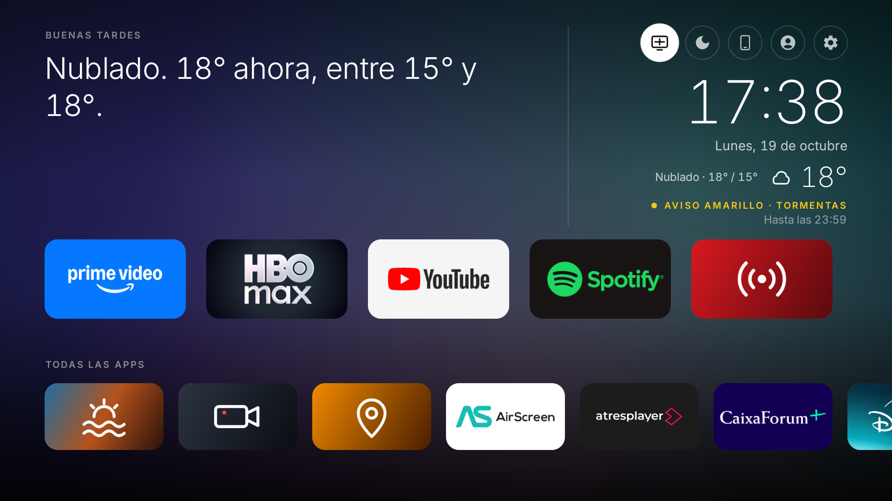
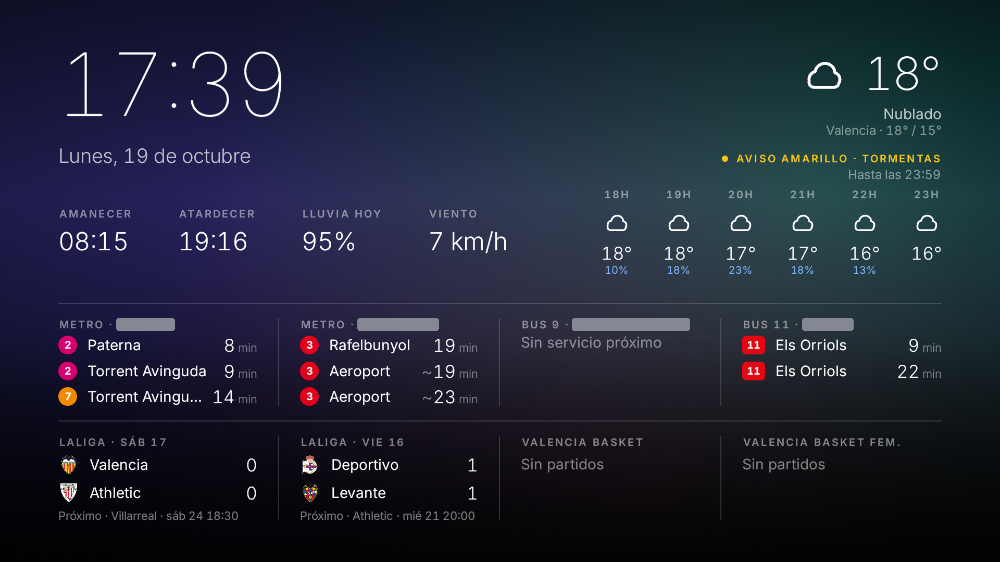
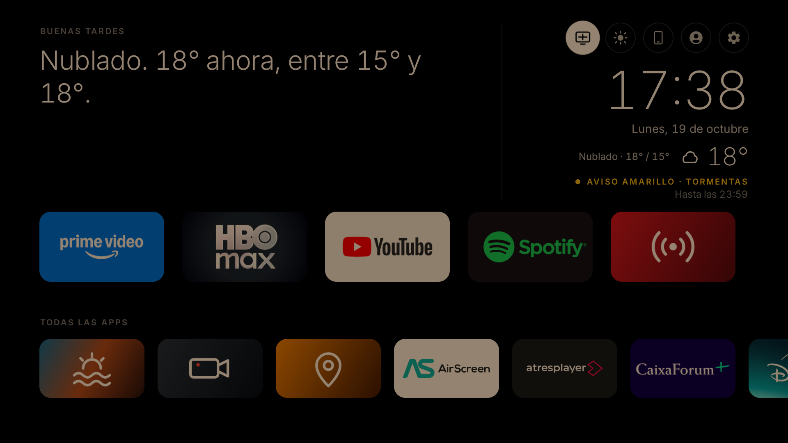
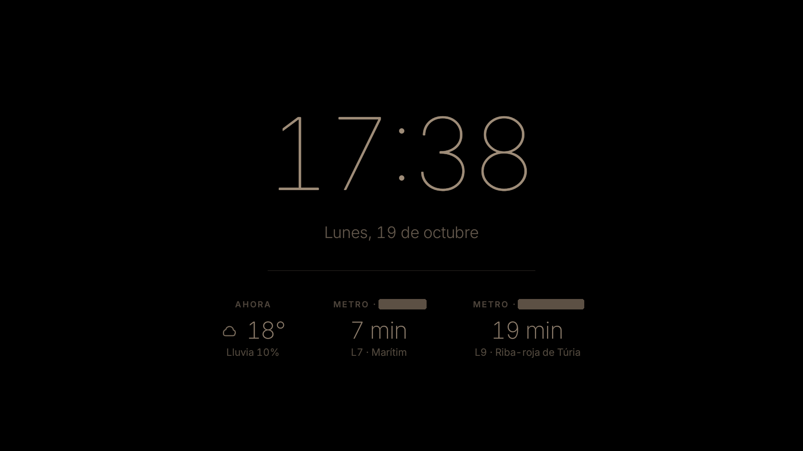

# Smart TV mods

Una Philips de 2009 sin nada de "smart" y un Chromecast con Google TV, convertidos en una tele de casa estilo Apple TV. Lo hicimos en un domingo.

- **Lumen:** launcher propio que sustituye al de Google, con un protagonista dinámico (partido en directo, notas de la familia, lo que suena, el tiempo).
- **Salvapantallas como panel:**
  - Hora y tiempo en Valencia, con los avisos de la AEMET.
  - Metro y EMT en tiempo real.
  - Resultados del Valencia CF, el Levante y el Valencia Basket.
  - Modo noche.
- **Mando en el móvil:** una web (PWA) para iPhone y Android, con superficie táctil, teclado, apps, notas y temporizador.
- **Alertas de gol y de rojas** encima de cualquier app.
- **Apps propias:** Radio, Ambientes, Cámaras de toda España y GeoGuesser València (multijugador con los móviles).

## Cómo se ve

| Inicio | Salvapantallas |
|---|---|
|  |  |
|  |  |

Arriba el modo claro y abajo el oscuro, que se cambia con el botón de la luna (y se vuelve con el del sol). El salvapantallas de noche es otra cosa distinta: negro, cálido y con lo justo para mirarlo a las tres de la mañana sin despertarse del todo. El fondo es la aurora generada, que es lo que sale cuando no hay fotos en `wallpapers/`.

Las paradas de metro y de bus salen tapadas a propósito.

Todo el código está en [`launcher/`](launcher/). En su [README](launcher/README.md) está cómo compilarlo e instalarlo, qué se cambió en el Chromecast y cómo deshacer cada cambio.

## Qué no está en el repo

- `mapillary-token.txt` y `lumen-admin.txt`: los creas tú en esta carpeta, y `deploy.ps1` los copia a la tele.
- `wallpapers/`: tus fotos de fondo.
- `ambientes/`: los vídeos de [Mixkit](https://mixkit.co). En [`CREDITOS.txt`](ambientes/CREDITOS.txt) está cuáles son y de dónde descargarlos.

Hecho con [Claude Code](https://claude.com/claude-code).
